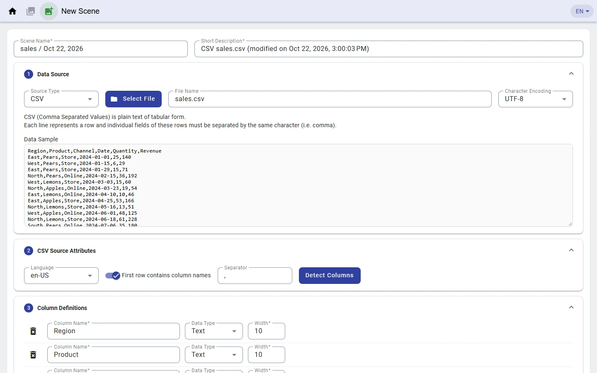
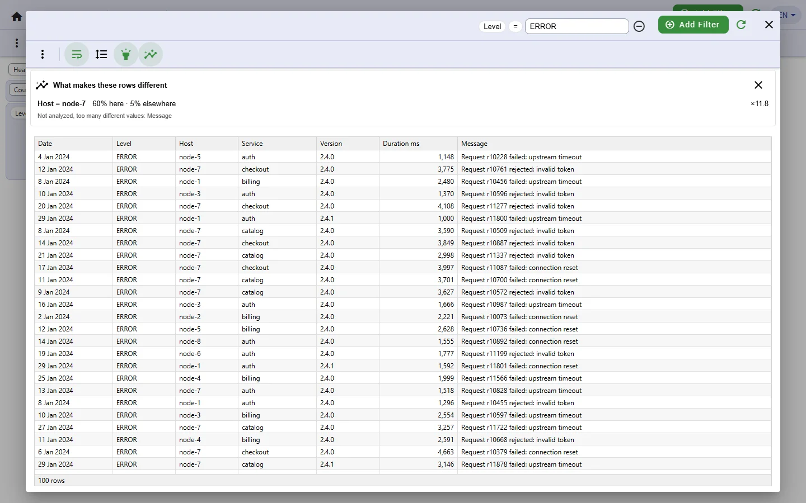
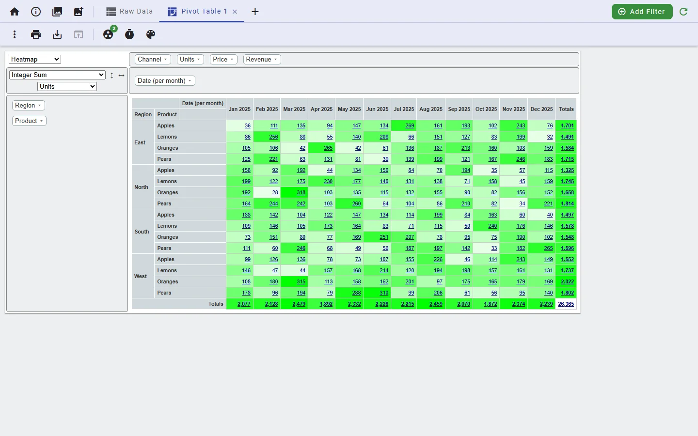

# Koia User Manual

Koia turns table-like data – CSV, Excel, JSON or log files – into raw data tables, pivot tables, charts, relationship graphs and dashboards, right in your browser. Your data stays in the browser or in your own CouchDB, it is never sent to a third-party server.

Labels in **bold** are the texts and tooltips of the English user interface. Each chapter that has a short video links it; all videos are on the [videos page](https://www.koia.io/intro/videos.html). The **User Manual** icon in the page headers and the link on the start page open this manual.

## Contents

1. [Quick start](#1-quick-start)
2. [Concepts](#2-concepts)
3. [Start page and storage](#3-start-page-and-storage)
4. [Create a scene from a file](#4-create-a-scene-from-a-file)
5. [Manage scenes](#5-manage-scenes)
6. [Raw data and filters](#6-raw-data-and-filters)
7. [Tabs and saved views](#7-tabs-and-saved-views)
8. [Drill down to the rows](#8-drill-down-to-the-rows)
9. [Explain these rows](#9-explain-these-rows)
10. [Message patterns](#10-message-patterns)
11. [Pivot tables](#11-pivot-tables)
12. [Dashboards](#12-dashboards)
13. [Charts](#13-charts)
14. [Summary tables](#14-summary-tables)
15. [Relationship graphs](#15-relationship-graphs)
16. [Share and export](#16-share-and-export)
17. [Launch from other programs](#17-launch-from-other-programs)
18. [Reference](#18-reference)

## 1. Quick start

Five minutes from the sample data to an explained finding:

1. Open [www.koia.io](https://www.koia.io) and choose **Log sample** on the start page. The raw data of 2,000 log rows opens.
2. Click **Add Filter**, choose the column *Level*, type `ERROR` and press Enter. 100 rows are left.
3. Click the **Explain these rows** icon in the table toolbar. Koia lists what makes the error rows different: 60% of them come from host *node-7*, against 5% of the other rows.
4. Click **+** (**Add view**) in the tab bar, choose **New Dashboard** and then **Generate Dashboard**.
5. Click a bar of any chart. A dialog shows the rows behind the bar – and offers **Explain these rows** again.

## 2. Concepts

| Term | Meaning |
|---|---|
| Scene | The data of one imported file (or of one sample, shared file or third-party program), with its column definitions, tabs and saved views. |
| Tab (view) | One way to look at the active scene: the fixed **Raw Data** tab, plus any number of pivot tables and dashboards. |
| Element | A tile on a dashboard: chart, relationship graph, summary table, text tile or note. |
| Filter | Restricts the rows of one tab. Every tab has its own filters. |
| Drill-down | A click on a chart bar, pivot cell, summary count or graph node opens a dialog with the rows behind it. |
| Saved view | A named snapshot of all tabs of a scene that can be restored later. |
| Storage | Where scenes live: this browser (IndexedDB) or a CouchDB. |

## 3. Start page and storage

The start page is where everything begins:

| Entry | What it does |
|---|---|
| **Load a file** | Creates a scene from a CSV, Excel, JSON or log file ([chapter 4](#4-create-a-scene-from-a-file)). |
| **Open a shared scene** | Adds a scene from a `.koia` file ([chapter 16](#16-share-and-export)). |
| **Sales sample** | Fruit sales per region, 2,000 rows with prepared tabs. |
| **Log sample** | App logs by level and host, 2,000 rows with prepared tabs. |
| **Continue with your scene** | Shown once scenes exist; opens the scenes page. |

The language button (**EN**, **DE**, **日**) in every page header switches between English, German and Japanese and is remembered. Besides the texts, the language also decides which language version of a sample opens, which log level names are recognized at import, and the suffix of new pattern columns.

### 3a. Storage

The line under the start entries tells where data is stored. **Change storage** switches between:

- **IndexedDB** – this browser. Nothing to install, up to 10,000 rows per scene. Data is lost when the browser data is cleared.
- **CouchDB** – faster with larger data, up to 100,000 rows per scene, survives clearing the browser and can be shared. Choosing it opens the **CouchDB Access** dialog with **Protocol**, **Host**, **Port**, **User** and **Password**.

Good to know:

- For a CouchDB on another machine, use HTTPS. Its password is kept only for the current browser tab unless you tick **Remember password in this browser** – it is then stored unencrypted.
- If a saved CouchDB cannot be reached at startup, Koia falls back to IndexedDB and says so.
- How to install CouchDB and configure CORS is described in the [README](../README.md#getting-started).

Video: [Managing scenes and navigating](https://www.koia.io/intro/videos.html)

## 4. Create a scene from a file

**Load a file** on the start page, or the **Add Scene** icon in any page header, opens the **New Scene** page. Name and description (**Scene Name**, **Short Description**) are filled in from the file; change them as you like.



1. **Data Source** – choose the **Source Type** (CSV, Excel, JSON or Log), click **Select File** and check the **Character Encoding** (CSV and Log). The **Data Sample** shows the start of the file.
2. Source attributes – set what the file needs, then click **Detect Columns**:

   | Source | Attributes |
   |---|---|
   | CSV | **First row contains column names**, **Separator** – both detected. |
   | Excel | **Sheet Name** – empty means the first sheet; column names in the first row. |
   | JSON | **Array JSONPath** to the array of flat objects; detected paths are offered. |
   | Log | **Line pattern** – see [4a](#4a-log-files). |

   **Language** decides how dates and numbers are parsed. **Adopt columns from existing Scene** copies the columns of another scene instead of detecting them. **Add ID column** (on by default) adds the column *ID* numbering the rows 1, 2, 3, …
3. **Column Definitions** – one row per column, detected from the first 100 rows. Delete irrelevant columns, rename them and choose their **Data Type**:

   | Detected | Selectable |
   |---|---|
   | Number or Time | Number, Text, Time |
   | Text | Text, Time |
   | Boolean | Boolean, Text |
   | Object | Object |

   A text column turned into Time needs a **Source Format**; the **Display Format** shows how times appear. **Width** is the column width in characters. A warning icon marks columns with values of incompatible types.
4. **Preview** – shows the mapped sample rows; rows with mapping errors carry a warning icon. Click **Load Data**. **Max. items** limits the rows, **Abort on data error** stops at the first bad row, **Cancel** stops the load (rows stored so far are kept). The scenes page opens when the load is done.

Good to know:

- Column names must not start with `$` or `_` and have at most 100 characters; scene names at most 40.
- Changing a source attribute discards the detected columns; detect them again.
- Text columns with values longer than 100 characters are not indexed: they cannot be sorted and Explain skips them.

### 4a. Log files

A plain-text log file is split into columns by a **Line pattern**. Koia picks the preset that matches the most lines; choose another preset or edit the pattern if needed.

| Preset | Typical source |
|---|---|
| `{Time:time} {Level:level} [{Thread}] {Logger} - {Message}` | Logback, Log4j |
| `{Time:time} [{Thread}] {Level:level} {Logger} - {Message}` | Logback, Log4j |
| `{Time:time} - {Logger} - {Level:level} - {Message}` | Python logging |
| `{Level:level}:{Logger}:{Message}` | Python default |
| `{Time:time} {Host} {Process}: {Message}` | syslog style |
| `{Time:time} {Level:level} {Message}` | simple logs |
| `{json}` | JSON Lines |
| `{logfmt}` | `key=value` pairs |

- `{Name}` becomes a column, `{Name:time}` a timestamp, `{Name:level}` a log level.
- A line that does not match is appended to the last column of the previous entry, so stack traces stay with their message. Blank lines are skipped.
- `:time` reads ISO-like times such as `2024-01-30 14:05:09.123` or `2024-01-30T14:05:09Z`.
- Rows are colored by level (errors red, warnings yellow); see **Highlight rows** in [chapter 6](#6-raw-data-and-filters).
- Log messages rarely repeat literally; add a pattern column for them right here ([chapter 10](#10-message-patterns)).

Video: [Creating a new scene](https://www.koia.io/intro/videos.html)

Video for log files: [Message patterns](https://www.koia.io/intro/videos.html)

## 5. Manage scenes

The **Scenes** icon in any page header opens the scenes page. The active scene is marked **Active** and listed first, the others by when they were last used.

- **Filter scenes** narrows the list by name or description.
- The play icon activates a scene (**Activate scene**) or returns to the active one (**Continue with active scene**).
- The **⋮** menu of a row offers **Show details**, **Share as file**, **Edit name and description** and **Delete**. While a row is edited (Enter saves, Esc cancels), the other rows are locked.
- **Delete all** – or **Delete filtered** while a filter is set – removes several scenes after a confirmation.

**Show details** lists the source of the scene and its columns with type, format and width. It is also where pattern columns are added later ([chapter 10](#10-message-patterns)). The **Show Scene Details** icon in the data toolbar shows the same details read-only.

Good to know: **Delete** of a single scene does not ask for confirmation.

Video: [Managing scenes and navigating](https://www.koia.io/intro/videos.html)

## 6. Raw data and filters

The **Raw Data** tab shows the rows of the active scene. Rows load as you scroll; the footer counts them.

| To | Do |
|---|---|
| Sort | Click a column header (or press Enter or Space on it): ascending, descending, unsorted. Only indexed columns sort. |
| Resize a column | Drag the right edge of its header. |
| See long values | **Show multi-line rows**, or hover a cell. |
| See objects | **Show nested objects** (scenes with Object columns), or click an Object cell. |
| Use import widths | **Observe specified column widths**. |
| Color rows | **Highlight rows** applies the row colors of log levels or of the Retrospective Log Analyzer. |
| Export | **⋮** → **Save As CSV**, **Save As Excel** or **Save As JSON** ([chapter 16](#16-share-and-export)). |
| Print | **Landscape Pages** or **Portrait Pages**, then **Print current view**. |

### Filters

**Add Filter** lists the columns. Text, Boolean and Object columns get a value filter at once; Number and Time columns ask for **Value** or **Value Range**.

A **value filter** shows column, operator and value. Click the column or the operator to change them, type the value and press Enter.

| Type | Operators |
|---|---|
| Text | contains, <, <=, =, ≠, >=, >, is empty, is not empty, is any of, is none of |
| Number | the same without contains |
| Time | is empty, is not empty |
| Boolean | =, is empty, is not empty |
| Object | contains, is empty, is not empty |

*contains* ignores case, *=* and *≠* do not. Separate the values of *is any of* and *is none of* with `;`.

A **value range filter** is a slider below the toolbar:

- Drag either handle, or the whole range.
- Click the range label to switch between **is inside range** and **is outside range**.
- **Define slider step size** sets the step, e.g. one day.
- **Reset value range filter** restores the full range.
- **Hide value range filters** saves space.

The ⊖ button removes a filter, **Refresh data** reloads the rows.

Good to know:

- Each tab has its own filters: a filter on Raw Data does not change a dashboard.
- With CouchDB, sorting by a column drops the rows where that column is empty.

## 7. Tabs and saved views

- **+** (**Add view**) adds a **New Pivot Table** or a **New Dashboard**.
- Double-click a tab, or press F2, to rename it.
- The × of a tab, or the Delete key, closes it. Koia asks first if the tab has content. **Raw Data** cannot be closed.
- Tabs are saved with the scene automatically.

A **saved view** keeps all tabs of a scene under a name, for example to return to an analysis later:

- **Save all tabs as view** stores all tabs, the active tab and the raw data state (filters, sorting, column widths). Saving under an existing name replaces that view.
- **Restore saved view** lists the views; restoring replaces all open tabs.
- **Manage Views** (end of that list) renames and deletes views.

Video: [Managing scenes and navigating](https://www.koia.io/intro/videos.html)

## 8. Drill down to the rows

Every number Koia shows leads to its rows:

| Where | How |
|---|---|
| Chart | Click a bar, slice or point. |
| Pivot table | Click a cell. |
| Summary table | Click a count. |
| Relationship graph | Double-click a node. |

The rows open in a dialog. Its filters are those of the tab plus one filter per clicked value; a clicked time group becomes a time range. You can add filters, sort, export and explain the rows there.

Good to know: values of computed columns cannot be drilled into.

## 9. Explain these rows

Explain answers *"what is special about these rows?"*. It compares the selected rows with the rest and lists the column values that are clearly over-represented in them.



1. Select rows: set a filter on the **Raw Data** tab, or drill down from a chart, pivot, summary or graph.
2. Click the **Explain these rows** icon in the table toolbar. The panel **What makes these rows different** opens.
3. Read the findings, strongest first:
   - `Host = node-7` – the over-represented value;
   - **60% here · 5% elsewhere** – its share in the selected rows and in the rest;
   - **×11.8** – how many times more frequent it is here, or **new** if it never occurs elsewhere.
4. Click a finding to narrow the rows to it. A click on another finding replaces that narrowing.

The rest is all other rows on the **Raw Data** tab, and the other rows of the tab in a drill-down dialog – so a chart bar is compared with the rest of its chart.

How it decides:

- Only indexed Text, Number and Boolean columns are analyzed. Columns you filtered on are not – after *Level = ERROR*, Level is no finding. Time and computed columns are not analyzed either.
- A value counts only if it occurs in at least 3 selected rows and at least 5% of them.
- Its share must be significantly higher than elsewhere: a one-sided two-proportion test with z ≥ 3, corrected for the number of values tested (1% family error rate).
- At most 15 findings are shown. Text columns with more than 500 different values are skipped and listed as not analyzed; Number columns with more than 50 are skipped silently.

Good to know:

- Findings of empty values read **(empty)** and can be clicked; **(null)** and **("")** cannot.
- On the **Raw Data** tab the icon appears once a filter is set. It is not offered for single-row dialogs, nor in page mode.

Video: [Explain these rows](https://www.koia.io/intro/videos.html)

## 10. Message patterns

Log messages rarely repeat literally – they differ in ids, numbers and addresses. A **pattern column** masks these variable parts, so the messages can be grouped:

```text
Request r10042 failed: upstream timeout   →   Request <*> failed: upstream timeout
```

Add a pattern column in one of two ways:

- **When creating a scene**: in the column definitions ([chapter 4](#4-create-a-scene-from-a-file)), the pattern icon of a free-text column (**Add a pattern column that masks variable parts such as ids and numbers**) inserts the column *Message pattern* next to it.
- **Later**: *Scenes page → ⋮ → Show details*, then **Add pattern column** on the column. This works for every scene, including scenes written by third-party programs. Koia processes all rows and reports **Pattern column "Message pattern" added**.

Then use the pattern column like any other column: as pivot field, chart or summary column, in filters and in Explain findings.

Good to know:

- Masked are URLs, e-mail addresses, quoted strings, words containing digits and long hex words.
- It is offered only for Text columns whose values are free text, once per column. Patterns are shortened to 100 characters.
- Pattern columns cannot be removed yet.

Video: [Message patterns](https://www.koia.io/intro/videos.html)

## 11. Pivot tables

**+** → **New Pivot Table** opens all columns as fields.



1. Drag fields into the rows and columns area. The arrow of a field opens its value filter (**Select All**, **Select None**, **Filter values**).
2. Choose the renderer – **Heatmap** (default), **Row Heatmap**, **Col Heatmap**, **Table** or **Table Barchart** – and the aggregator, e.g. Count, Sum, Average, Median, Minimum, Maximum or Count Unique Values.
3. Click a cell to see its rows ([chapter 8](#8-drill-down-to-the-rows)).

The toolbar of the tab adds:

- **Define Value Grouping...** – group a number column into ranges (**Add Value Range**, **Up to:**).
- **Time Unit Grouping** – group a time column by millisecond up to year.
- **Show Row Totals** / **Show Column Totals**, and **Heatmap Colors** for negative and positive values.
- **⋮** → **Save As Excel**.

Video: [Pivot tables and export](https://www.koia.io/intro/videos.html)

## 12. Dashboards

**+** → **New Dashboard** opens the **Create View** dialog: start with a **Chart**, **Relationship Graph** or **Summary Table**, or let Koia **Generate Dashboard** from the data. The generator picks suitable columns and fills whole grid rows with charts and summary tables; each run differs. **Regenerate Dashboard** replaces all elements after a confirmation.


**Layouts** (dashboard toolbar):

- **Snap to Grid** – tiles fill grid cells. The **⋮** menu sets **Grid Columns** (1–5) and the **Grid Cell Ratio (width:height)**.
- **Free Canvas** – tiles go anywhere; edges snap to other tiles.
- **Landscape Pages** / **Portrait Pages** – the canvas is split into sheets; **Print current view** prints them.

**Elements**: **Add Chart**, **Add Relationship Graph**, **Add Summary**, **Add Text Tile** and **Add Note** (a sticky note above the tiles). Each tile has a header with:

- the title – click it to edit; left alone, Koia generates it;
- **Configure...** – opens the side bar of the element (chapters 13–15);
- **Toggle resizable chart margin** (charts);
- **Move** and **Delete**;
- **⋮** – **Column Span** and **Row Span** (grid), **Bring to Front** and **Send to Back** (canvas), and the export of the element.

Click an empty part of a tile to select it, then drag its corner to resize it. Esc clears the selection.

Text tiles and notes have a toolbar while edited: **Font**, **Font Size**, **Bold**, **Italic**, **Underline**, alignment, **Text Color**, **Background Color** and **Border**.

Good to know: **Delete** on a tile does not ask for confirmation.

Video: [Dashboards and charts](https://www.koia.io/intro/videos.html)

## 13. Charts

**Configure...** on a chart opens its side bar. Choose the chart type at the top:

| Chart types | Max. values |
|---|---|
| Pie, Doughnut, Radar, Polar Area | 1,000 |
| Bar, Horizontal Bar | 5,000 |
| Linear Bar, Linear Horizontal Bar, Line, Area, Scatter | – |

Then set the panels:

- **Values** – the data column(s); several columns must all be numbers. **Computed Column** creates a column from two number columns, e.g. a percentage.
- **Value Mode** – **Count Distinct Values**, **Individual Values**, **Aggregate Values** or **Count Rows**; offered depending on chart type and columns. **Aggregation** picks Sum, Average, Median, Max or Min.
- **Group by** (X-axis) – with **Time Unit Grouping** for time columns.
- **Value Splitting** – one series per value of the selected columns.
- **Stacked**, **Show Distinct Scales**, **Color Scheme**, legend position, axis titles and label rotation.

A click on a bar, slice or point shows its rows ([chapter 8](#8-drill-down-to-the-rows)). **⋮** → **Save As PNG** exports the chart.

Video: [Dashboards and charts](https://www.koia.io/intro/videos.html)

## 14. Summary tables

A summary table counts or aggregates rows per group, over several hierarchy levels.

1. **Data** – choose the column and **Count Distinct Values** or **Aggregate Values**. For number columns, **Define value grouping** groups the values into ranges.
2. **Hierarchy** – drag the group-by columns into **Selected Columns**; their order sets the levels. Time columns can be grouped by a time unit.
3. **Aggregation** – drag Count, Average, Median, Max, Min or Sum into **Selected Aggregations**.

Click a header to sort. The **Overall** row shows the totals. Each count links to its rows (**Show Data...**). **⋮** → **Save As CSV**, **Save As JSON** or **Save As Excel** exports the table.

Good to know: counts are not clickable while a value grouping is used.

Video: [Summary tables](https://www.koia.io/intro/videos.html)

## 15. Relationship graphs

A relationship graph shows how the values of several columns hang together, as a tree of nodes from a root.

- **Data Hierarchy** – drag columns into **Selected Columns**; each column is one level.
- **Other** – sliders for the force layout: **Link Distance**, **Link Strength**, **Friction**, **Charge**, **Gravity**, **Theta**, **Alpha**.
- Drag nodes to arrange them. Hovering a node shows its value and number of entries; a double-click shows its rows.

Good to know: a graph shows at most 1,000 nodes – filter the data or use a chart for more. Graphs cannot be exported.

Video: [Relationship graphs](https://www.koia.io/intro/videos.html)

## 16. Share and export

**Share a scene** with all its tabs, saved views and rows as one `.koia` file:

- *Scenes page → ⋮ → Share as file*, or
- the **Share as file** icon in the toolbar of the active scene.

**Open a shared scene** on the start page, on the scenes page or in the toolbar adds the file as a new scene and opens it. Click the button again to cancel. Nobody needs a server or an account – just the file.

Good to know:

- The scene keeps its name; if the name is taken, a number is appended.
- A scene file with more rows than the storage holds per scene (10,000 for IndexedDB) is refused.

**Export** data for other tools:

| From | Formats | Content |
|---|---|---|
| Raw data (**⋮**) | CSV, Excel, JSON | All filtered rows, not just the loaded ones. |
| Pivot table (**⋮**) | Excel | The table as shown. |
| Chart (tile **⋮**) | PNG | The chart image. |
| Summary table (tile **⋮**) | CSV, JSON, Excel | The table. |

Video: [Sharing scenes as files](https://www.koia.io/intro/videos.html)

## 17. Launch from other programs

Programs such as the [Retrospective Log Analyzer](https://retrospective.centeractive.com/) write scenes to a CouchDB and open them in Koia with a launch URL:

```text
https://www.koia.io/?lang=de#host=localhost&port=5984&user=admin&pw=YWRtaW4=&scene_id=<id>
```

- `host`, `port`, `user` and `pw` (Base64) are all required, plus `scene_id`. `protocol=HTTPS` is optional, HTTP is the default.
- Put them in the fragment after `#`, which never reaches a web server. The fragment is used only when it contains `host`; otherwise the query string is read.
- `lang` (`en`, `de`, `ja`) is read from the query string only, so it goes before the `#`.
- The connection is used for the current browser tab only.

Koia checks the scene against the scene format when it is activated; see [Scene format](../README.md#scene-format).

## 18. Reference

### Keyboard

| Key | Where | Action |
|---|---|---|
| F2 or double-click | Tab | Rename |
| Delete | Tab | Close |
| Enter or Space | Column header | Sort |
| Enter | Filter value | Apply |
| Esc | Dashboard | Clear the tile selection |
| Enter / Esc | Scene name being edited | Save / cancel |

### Limits

| What | Limit |
|---|---|
| Rows per scene | 10,000 (IndexedDB), 100,000 (CouchDB); **Max. items** at import |
| Sample rows for column detection | 100 |
| Chart values | 1,000 (Pie, Doughnut, Radar, Polar Area), 5,000 (Bar, Horizontal Bar) |
| Graph nodes | 1,000 |
| Explain | 15 findings; Text columns ≤ 500, Number columns ≤ 50 different values |
| Indexed text, pattern length | 100 characters |
| Names | scene 40, column 100, view and tab 40 characters |
